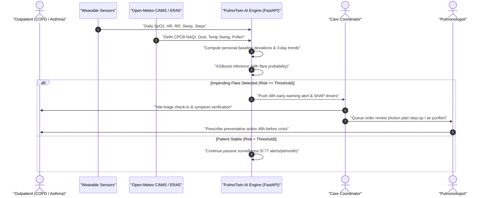
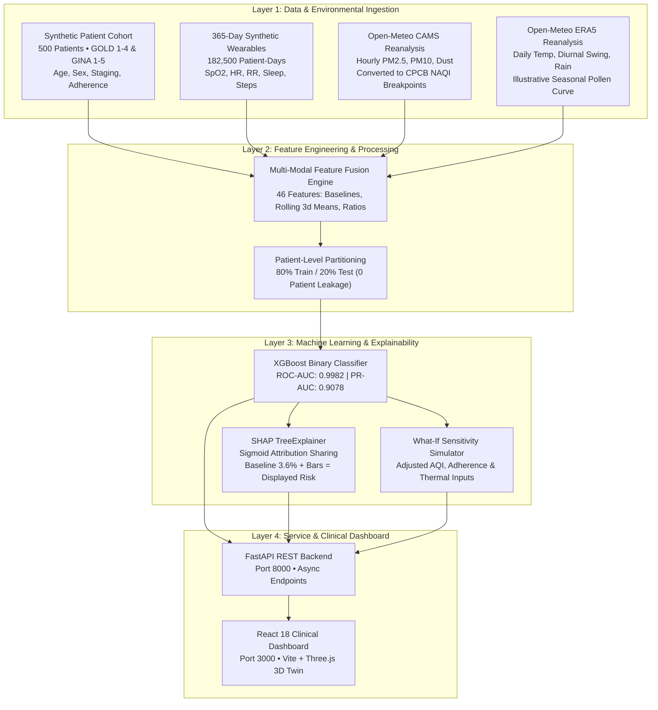

# PulmoTwin: 48-Hour Outpatient Respiratory Digital Twin

> **Happiest Health Digital Twin Challenge 2026 • Prototype & Code Submission**  
> *A Clinical Decision-Support System Forecasting Acute COPD & Asthma Exacerbations 48 Hours Ahead by Fusing Wearable Telemetry, Patient Phenotypes, and Delhi CAMS Atmospheric Intelligence.*

[](LICENSE)
[](https://www.python.org/)
[](https://fastapi.tiangolo.com/)
[](https://react.dev/)
[](data/)

---

## Submission Checklist

| # | Submission Requirement | Documentation Section |
| :-: | :--- | :--- |
| 1 | **Team Details** | [1. Team Information](#1-team-information) |
| 2 | **College Affiliation** | [2. Institution & Affiliation](#2-institution--affiliation) |
| 3 | **Project Title & Tagline** | [3. Project Title & Executive Summary](#3-project-title--executive-summary) |
| 4 | **Problem Statement** | [4. Problem Statement & Clinical Context](#4-problem-statement--clinical-context) |
| 5 | **Healthcare Use Case** | [5. Healthcare Use Case & Workflow](#5-healthcare-use-case--workflow) |
| 6 | **Technical Stack & Architecture** | [6. Technical Stack & Architecture](#6-technical-stack--architecture) |
| 7 | **AI / ML Model Details & Ablation** | [7. AI/ML Model Details & Validation](#7-aiml-model-details--validation) |
| 8 | **Working Prototype Video Demo** | [8. Video Demonstration](#8-video-demonstration) |
| 9 | **Open-Source License** | [9. Open-Source License (MIT)](#9-open-source-license) |
| 10 | **System Architecture Diagram** | [10. System Architecture Deliverable (PDF)](#10-system-architecture-deliverable) |
| 11 | **Presentation Pitch Deck** | [11. Final Presentation Pitch Deck (PDF)](#11-final-presentation-pitch-deck) |
| 12 | **Public Access & Run Instructions** | [12. Reproducibility & Quick-Start Guide](#12-reproducibility--quick-start-guide) |
| 13 | **Scientific Limitations** | [13. Limitations & Disclaimers](#13-limitations--disclaimers) |

---

## 1. Team Information

- **Developer**: Monalika Doda (Solo Developer)
- **Institution**: SRM University Delhi-NCR
- **Repository**: [https://github.com/MonalikaDoda/PulmoTwin](https://github.com/MonalikaDoda/PulmoTwin)
- **Challenge**: Happiest Health Digital Twin Challenge 2026
- **Clinical Guideline Reference**: Built in reference to the Global Initiative for Chronic Obstructive Lung Disease ([GOLD 2024](https://goldcopd.org/2024-gold-report/)) and the Global Initiative for Asthma ([GINA 2023](https://ginasthma.org/reports/)).

---

## 3. Project Title & Executive Summary

### **PulmoTwin: 48-Hour Outpatient Respiratory Digital Twin**
*Continuous Early Warning Forecasting of Acute COPD & Asthma Flare-Ups through Wearable Biomarkers and Atmospheric Intelligence.*

PulmoTwin is a proof-of-concept healthcare Digital Twin designed to forecast impending acute exacerbations (flare-ups) in COPD and asthma patients **48 hours in advance**. It fuses:
1. **Static Patient Phenotypes**: Synthetic cohort (N=500) covering age, sex, GOLD/GINA staging, smoking pack-years, maintenance inhaler adherence, and comorbidities.
2. **Continuous Dynamic Wearables**: 365 daily synthetic records per patient (182,500 patient-days) tracking blood oxygen ($SpO_2$), resting heart rate, respiratory rate, sleep duration, and daily step counts with personal baselines and pre-flare drift.
3. **Real Modelled Atmospheric Data**: High-resolution atmospheric air quality from Open-Meteo Copernicus Atmosphere Monitoring Service (**CAMS**) converted to Indian Central Pollution Control Board (**CPCB**) National Air Quality Index (**NAQI**), daily **ECMWF ERA5** weather reanalysis (temperature, diurnal swing, dust, precipitation), and an illustrative seasonal pollen curve.

The platform provides an editorial-grade clinical dashboard featuring an interactive **3D breathing digital twin lung** (Three.js), **TreeExplainer SHAP attribution**, a **365-day live longitudinal simulation controller**, and a **What-If sensitivity simulator** to explore how model predictions respond to adjusted environmental and adherence inputs.

> **Clinical Disclaimer:** *PulmoTwin is a research prototype and clinical decision-support tool. It is not an automated diagnostic device or a replacement for professional clinical judgment.*

---

## 4. Problem Statement & Clinical Context

### The Chronic Airway Crisis in Urban India
Chronic respiratory diseases represent a major public health burden in India:
- According to the **ICMR, PHFI, and Lancet Global Health State-Level Disease Burden Initiative (2018)**, chronic respiratory diseases accounted for **10.9% of total deaths** and **6.4% of total DALYs** in India, with COPD and asthma being the primary contributors ([Lancet Global Health, 2018](https://doi.org/10.1016/S2214-109X(18)30409-1)).
- In Delhi NCR, patients face severe seasonal environmental stressors, including winter particulate episodes where $PM_{2.5}$ frequently exceeds national standards, sharp diurnal temperature swings ($\Delta T > 10^\circ\text{C}$), and mineral dust.

### The Clinical Gap: Reactive vs. Proactive Care
Traditional pulmonology operates reactively: patients typically seek medical attention only after severe breathlessness, respiratory acidosis, and gas exchange failure have already occurred. In contrast, sub-clinical airway inflammation typically develops **48 to 72 hours** prior to severe decompensation, exhibiting subtle physiological drift:
- Gradual $SpO_2$ decline of **1.5% to 3.0%** below personal baseline.
- Resting heart rate elevation of **6 to 10 bpm** (compensatory tachycardia).
- Respiratory rate elevation of **2 to 4 rpm** (sub-clinical tachypnea).
- Nocturnal sleep debt accumulation and exertional reduction in daily step counts.

PulmoTwin explores whether continuous multi-modal data can detect these pre-flare patterns early to support timely outpatient triage.

---

## 5. Healthcare Use Case & Workflow



---

## 6. Technical Stack & Architecture

### System Architecture Pipeline

The complete system architecture diagram is available in vector format: [`docs/PulmoTwin_Architecture_Diagram.pdf`](docs/PulmoTwin_Architecture_Diagram.pdf).



### Technology Matrix

| Layer | Technologies & Libraries | Function |
| :--- | :--- | :--- |
| **Data Generation** | Python 3.10+, NumPy, Pandas, SciPy | Synthetic cohort generation, personal baseline modeling, AR(1) sensor noise, pre-flare drift simulation. |
| **Environmental Ingestion** | Open-Meteo API, Copernicus CAMS, ECMWF ERA5 | Automated fetching and caching of Delhi atmospheric air quality, dust, and weather reanalysis. |
| **Machine Learning** | XGBoost 2.0+, Scikit-Learn, SHAP 0.44+ | Gradient boosted classifier, GroupShuffleSplit cross-validation, TreeExplainer log-odds attribution. |
| **Backend Service** | FastAPI, Starlette, Pydantic v2, Uvicorn | Asynchronous REST service serving ranked patient cohorts, telemetry replay, and What-If simulations. |
| **Frontend Application** | React 18, Vite, Three.js (`@react-three/fiber`), Lucide React | Clinical dashboard, 3D animated lung twin, light/glass telemetry card, and interactive map. |
| **Fault Tolerance** | React Error Boundaries | Component-level error handling preventing page crashes. |

---

## 7. AI/ML Model Details & Validation

*All metrics in this section are read directly from [`model/comprehensive_metrics.json`](model/comprehensive_metrics.json) and [`model/lead_time_analysis.json`](model/lead_time_analysis.json).*

### 7.1 Data Sources & Provenance

| Modality | Features Captured | Source & Provenance | Classification |
| :--- | :--- | :--- | :--- |
| **Air Quality & Dust** | CPCB NAQI, PM2.5, PM10, Dust ($\mu\text{g}/\text{m}^3$) | Open-Meteo / Copernicus Atmosphere Monitoring Service (**CAMS**) atmospheric reanalysis mapped to official Indian CPCB NAQI breakpoints. | **Real Modelled / Reanalysis Data** *(Atmospheric model, not hardware station feeds)* |
| **Weather** | Mean Temp, Diurnal Swing ($\Delta T$), Humidity, Rain, Wind | Open-Meteo / ECMWF **ERA5-Land** Reanalysis (365 days across 5 Delhi monitoring zones). | **Real Modelled / Reanalysis Data** |
| **Seasonal Pollen** | Seasonal Index (0–100) | Illustrative seasonal curve with peaks placed near seasons in Delhi pollen calendars; not fitted to measured data. | **Illustrative Seasonal Model** *(Clearly labeled; not sensor trap counts)* |
| **Static Patient EHR** | Age, Sex, GOLD/GINA Stage, Smoking Pack-Years, Inhaler Adherence | Synthetic clinical generator following **GOLD 2024** and **GINA 2023** distributions. | **Synthetic Clinical Cohort** *(500 patients, zero real patient data)* |
| **Dynamic Wearables** | SpO2, Resting HR, Resp Rate, Sleep, Daily Steps | 365-day longitudinal time-series (182,500 patient-days) with individual baselines, noise, and pre-flare drift. | **Synthetic Wearable Telemetry** |

> **Data Attribution Notice:** Weather and air quality data by [Open-Meteo.com](https://open-meteo.com/) under [Creative Commons Attribution 4.0 International (CC BY 4.0)](https://creativecommons.org/licenses/by/4.0/). Copernicus Atmosphere Monitoring Service information is used.

### 7.2 Delhi Seasonal Pollen Formula
The seasonal pollen index $P(t)$ is modeled as an illustrative seasonal curve with peaks placed near calendar seasons in Delhi pollen calendars:

$$P(\text{DOY}, \text{Precip}) = \text{clip}\left( 12.0 + 85.0 \cdot \exp\left( -0.5 \left( \frac{\text{DOY} - 75}{16.0} \right)^2 \right) + 70.0 \cdot \exp\left( -0.5 \left( \frac{\text{DOY} - 290}{18.0} \right)^2 \right) + \epsilon,\; 2.0,\; 100.0 \right) \times W_{\text{rain}}$$

Where:
- $\text{DOY} \in [1, 365]$ is the calendar day of the year.
- **Spring Peak** ($\text{DOY} = 75$, mid-March): Placed near the Delhi tree pollination window (amplitude $85.0$, $\sigma = 16.0$ days).
- **Autumn Peak** ($\text{DOY} = 290$, mid-October): Placed near the Delhi weed/grass pollination window (amplitude $70.0$, $\sigma = 18.0$ days).
- **Baseline Background & Noise**: Constant background $12.0$, stochastic variance $\epsilon \sim \mathcal{N}(0, 3.5^2)$.
- **Precipitation Washout**: $W_{\text{rain}} = \max\left(0.2,\, 1.0 - \frac{\text{Precip (mm)}}{15.0}\right)$ for rain $> 2.0\text{ mm}$.
- *Notice: This is an illustrative seasonal mathematical formula; it is not fitted to measured aerobiological pollen trap data.*

---

### 7.3 Multi-Modal Ablation Study (Exact Real Values)

Evaluated on an independent, held-out test cohort of **100 patients (36,500 patient-days)** with strict patient-level separation (zero data leakage):

| Model Stage | Modalities Included | Feature Count | ROC-AUC | PR-AUC | Test Recall (48h) | Test Precision | F1-Score |
| :--- | :--- | :---: | :---: | :---: | :---: | :---: | :---: |
| **M1: Vitals Only** | Wearables (Baselines, Deviations, 3d Trends) | 17 | 0.9982 | 0.9042 | 94.09% | 75.11% | 0.8353 |
| **M2: Vitals + EHR** | + Age, Staging, Smoking Pack-Years, Comorbidities | 27 | 0.9981 | 0.9020 | 93.82% | 76.03% | 0.8400 |
| **M3: Vitals + EHR + CAMS AQI** | + Delhi CPCB NAQI, PM2.5, PM10, 3d Rolling Exposure | 35 | 0.9982 | 0.9068 | 93.82% | 75.62% | 0.8374 |
| **M4: Full Multi-Modal** | **+ Weather, Atmospheric Dust, Temp Swing, Pollen** | **46** | **0.9982** | **0.9078** | **93.41%** | **75.63%** | **0.8358** |

> **Plain Finding on Environmental Features:**  
> On this synthetic dataset, continuous wearable vitals (M1) already yield **PR-AUC 0.9042** and **F1 0.8353**. Adding static EHR features (M2), CAMS air quality (M3), and weather/dust/pollen (M4) produces a **virtually negligible quantitative gain** (**+0.0036 PR-AUC** and **+0.0005 F1**).  
> This occurs because the synthetic generator's 2–3 day vital sign trajectory drift (SpO2 drop, tachycardia, step drop) provides a strong predictive signal that dominates the tree splits.

---

### 7.4 Warning Lead-Time Horizons & Clinical Workload (Exact Real Values)

From [`model/lead_time_analysis.json`](model/lead_time_analysis.json) across **372 test flare events** in the held-out cohort:
- **48 Hours Ahead Warning**: **100.0% sensitivity** on synthetic test flare labels.
- **36 Hours Ahead Warning**: **100.0% sensitivity**.
- **24 Hours Ahead Warning**: **100.0% sensitivity**.
- **12 Hours Ahead Warning**: **95.4% sensitivity** (0.9543).
- **Clinical Alert Workload**:
  - **Average Alerts per Patient per Month**: **0.77 alerts** (~9.19 alerts / patient / year).
  - **Episode Grouping**: Consecutive alert days are clustered into single multi-day clinical episodes (e.g., *"8–9 Jan, 2-day episode • Peak 98.4% Risk"*), grouping redundant daily alarms into a single event.

---

### 7.5 Wearable Sensor Dropout Robustness Test (Exact Real Values)

From [`model/comprehensive_metrics.json`](model/comprehensive_metrics.json), simulating uncharged devices or non-wear:

| Sensor Dropout Rate | ROC-AUC | Test Recall (48h) | Precision | F1-Score | Status |
| :---: | :---: | :---: | :---: | :---: | :--- |
| **0% (Clean Baseline)** | **0.9982** | **93.41%** | **75.63%** | **0.8358** | Full Multi-Sensor Telemetry |
| **10% Random Dropout** | 0.9963 | 78.76% | 75.32% | 0.7700 | Resilient (<8% F1 loss) |
| **20% Random Dropout** | 0.9925 | 61.02% | 78.68% | 0.6874 | Graceful Degradation |
| **30% Random Dropout** | 0.9861 | 37.90% | 78.55% | 0.5113 | Missing Telemetry Alert Triggered |

---

### 7.6 Explainable AI & What-If Sensitivity Simulator

#### SHAP Attribution Sharing
Using `shap.TreeExplainer`, local feature contributions in log-odds space are converted into probability percentage point shifts from the **Cohort Reference Prior (3.6%)**:
$$\text{Cohort Baseline (3.6\%)} + \sum_{i=1}^{9} \text{Factor Impact}_i \equiv \text{Displayed 48h Risk\%}$$

#### What-If Sensitivity Simulator
The What-If engine recalculates the model's predicted probability when users modify environmental or adherence inputs:
- **Indoor Air Quality Delta**: Adjusts AQI by 0 to -150.
- **Inhaler Adherence Delta**: Adjusts adherence by +0% to +50%.
- **Thermal Swing Delta**: Adjusts diurnal swing by 0 to -8°C.
- *Notice: This tool illustrates model mathematical sensitivity on synthetic feature distributions. It does not demonstrate or claim a verified clinical intervention effect in real patients.*

---

## 8. Video Demonstration

A video walkthrough of the prototype is provided here:

> 🎬 **[Demo Video Walkthrough (Unlisted YouTube)](YOUR_YOUTUBE_LINK_HERE)**  
> *(Replace `YOUR_YOUTUBE_LINK_HERE` with your unlisted YouTube demonstration video link).*

---

## 9. Open-Source License

PulmoTwin is released under the **MIT License**.  
See the full license text in [LICENSE](LICENSE).  
Copyright (c) 2026 Monalika Doda.

---

## 10. System Architecture Deliverable

The vector system architecture document is available in the `docs/` directory:
- 📄 **Architecture Diagram (PDF)**: [`docs/PulmoTwin_Architecture_Diagram.pdf`](docs/PulmoTwin_Architecture_Diagram.pdf)
- 📝 **Architecture Technical Specification**: [`docs/architecture.md`](docs/architecture.md)

---

## 11. Final Presentation Pitch Deck

The multi-slide presentation deck is available in the `docs/` directory:
- 📊 **Presentation Deck (PDF)**: [`docs/PulmoTwin_Presentation_Deck.pdf`](docs/PulmoTwin_Presentation_Deck.pdf)
- 📋 **Slide-by-Slide Narrative Outline**: [`docs/deck_outline.md`](docs/deck_outline.md)

---

## 12. Reproducibility & Quick-Start Guide

### Prerequisites
- Python 3.10, 3.11, or 3.12
- Node.js 18+ and npm
- Git

### Step 1: Clone Repository
```bash
git clone https://github.com/MonalikaDoda/PulmoTwin.git
cd PulmoTwin
```

### Step 2: Install Python Dependencies
```bash
pip install -r requirements.txt
```

### Step 3: Run Model Pipeline & Verify Data (Pre-computed Cache Included)
```bash
# 1. Fetch Delhi CAMS & ERA5 weather data
python data/fetch_delhi_aqi.py

# 2. Generate 500-patient synthetic cohort & 365-day wearable time-series
python data/generate_cohort.py

# 3. Train multi-modal XGBoost, run ablation & generate SHAP explainers
python model/train_model.py
```

### Step 4: Launch FastAPI Backend Server
```bash
uvicorn api.main:app --host 0.0.0.0 --port 8000 --reload
```
- **Backend Port**: `8000`
- **Interactive OpenAPI / Swagger Docs**: [http://localhost:8000/docs](http://localhost:8000/docs)
- **Health Check**: [http://localhost:8000/api/health](http://localhost:8000/api/health)

### Step 5: Launch React Clinical Dashboard
In a separate terminal:
```bash
cd dashboard
npm install
npm run dev
```
- **Frontend Port**: `3000` (or Vite assigned port)
- Open [http://localhost:3000](http://localhost:3000) in your browser.

---

## 13. Limitations & Disclaimers

1. **Synthetic Patient Data**: All patient demographics, clinical stages, and wearable time-series are synthetic. No real patient health information (PHI) was used.
2. **Rule-Based Labels**: Flare-up event labels were generated according to our own physiological drift simulation rules (SpO2 drops, heart rate elevation, step reduction). High machine learning test metrics reflect the model's ability to recover these generator rules on synthetic data, rather than clinical efficacy.
3. **No Real Patient Clinical Evidence**: There is currently no prospective or retrospective clinical trial evidence demonstrating that this system is safe, accurate, or effective in real-world clinical care.
4. **Modelled Environmental Data**: Air quality and weather inputs are from Open-Meteo reanalysis models (Copernicus CAMS and ECMWF ERA5), not physical hardware monitoring stations.
5. **Illustrative Pollen Curve**: The seasonal pollen curve is an illustrative mathematical curve placed near Delhi calendar seasons; it is not fitted to measured aerobiological pollen trap counts.
6. **Decision-Support Prototype**: PulmoTwin is a research prototype intended for clinical decision-support and workflow exploration. It is not an autonomous diagnostic or treatment device.
7. **AI Assistance Disclosure**: Built with AI coding assistance (Antigravity).

---

*Happiest Health Digital Twin Challenge 2026 • Research Decision-Support Prototype*
