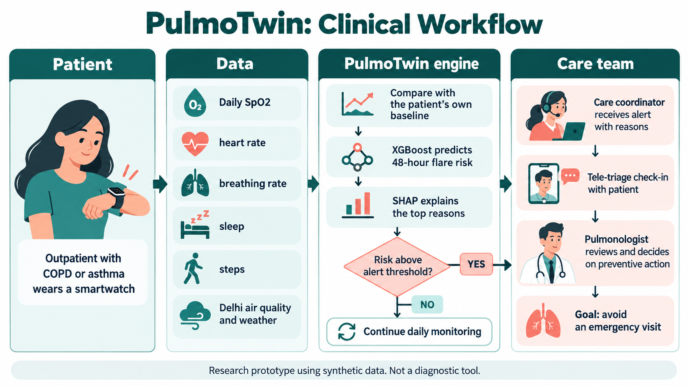
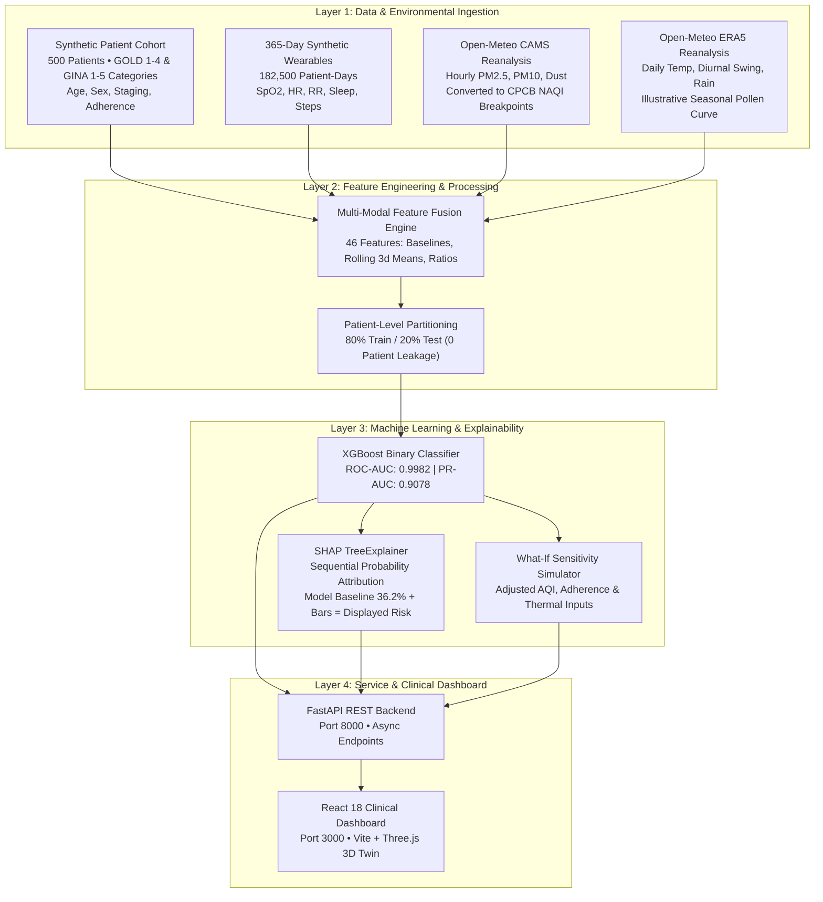

# PulmoTwin: 48-Hour Outpatient Respiratory Digital Twin

> **Happiest Health Digital Twin Challenge 2026 • Prototype & Code Submission**  
> *A Clinical Decision-Support System Forecasting Acute COPD & Asthma Exacerbations 48 Hours Ahead by Fusing Wearable Telemetry, Patient Phenotypes, and Delhi CAMS Atmospheric Intelligence.*

[](LICENSE)
[](https://www.python.org/)
[](https://fastapi.tiangolo.com/)
[](https://react.dev/)
[](data/)

---

## Submission Checklist

| # | Submission Requirement | Documentation Section |
| :-: | :--- | :--- |
| 1 | **Team Details & College Affiliation** | [1. Team Information](#1-team-information) |
| 2 | **Project Title & Tagline** | [2. Project Title & Executive Summary](#2-project-title--executive-summary) |
| 3 | **Problem Statement** | [3. Problem Statement & Clinical Context](#3-problem-statement--clinical-context) |
| 4 | **Healthcare Use Case** | [4. Healthcare Use Case & Workflow](#4-healthcare-use-case--workflow) |
| 5 | **Technical Stack & Architecture** | [5. Technical Stack & Architecture](#5-technical-stack--architecture) |
| 6 | **AI / ML Model Details & Ablation** | [6. AI/ML Model Details & Validation](#6-aiml-model-details--validation) |
| 7 | **Working Prototype Video Demo** | [7. Video Demonstration](#7-video-demonstration) |
| 8 | **Open-Source License** | [8. Open-Source License (MIT)](#8-open-source-license) |
| 9 | **System Architecture Deliverable** | [9. System Architecture Deliverable (PDF)](#9-system-architecture-deliverable) |
| 10 | **Presentation Pitch Deck** | [10. Final Presentation Pitch Deck (PDF)](#10-final-presentation-pitch-deck) |
| 11 | **Public Access & Run Instructions** | [11. Reproducibility & Quick-Start Guide](#11-reproducibility--quick-start-guide) |
| 12 | **Scientific Limitations** | [12. Limitations & Disclaimers](#12-limitations--disclaimers) |
| 13 | **Assets & Credits** | [13. Assets & Credits](#13-assets--credits) |

---

## 1. Team Information

- **Developer**: Monalika Doda (Solo Developer)
- **Institution**: SRM University Delhi-NCR
- **Repository**: [https://github.com/MonalikaDoda/PulmoTwin](https://github.com/MonalikaDoda/PulmoTwin)
- **Challenge**: Happiest Health Digital Twin Challenge 2026


---

## 2. Project Title & Executive Summary

### **PulmoTwin: 48-Hour Outpatient Respiratory Digital Twin**
*Continuous Early Warning Forecasting of Acute COPD & Asthma Flare-Ups through Wearable Biomarkers and Atmospheric Intelligence.*

PulmoTwin is a proof-of-concept healthcare Digital Twin designed to forecast impending acute exacerbations (flare-ups) in COPD and asthma patients **48 hours in advance**. It fuses:
1. **Static Patient Phenotypes**: Synthetic cohort (N=500) covering age, sex, GOLD/GINA staging (uses GOLD/GINA stage categories; proportions are our assumptions), smoking pack-years, maintenance inhaler adherence, and comorbidities.
2. **Continuous Dynamic Wearables**: 365 daily synthetic records per patient (182,500 patient-days) tracking blood oxygen ($SpO_2$), resting heart rate, respiratory rate, sleep duration, and daily step counts with personal baselines and pre-flare drift.
3. **Real Modelled Atmospheric Data**: High-resolution atmospheric air quality from Open-Meteo Copernicus Atmosphere Monitoring Service (**CAMS**) converted to Indian Central Pollution Control Board (**CPCB**) National Air Quality Index (**NAQI**), daily **ECMWF ERA5** weather reanalysis (temperature, diurnal swing, dust, precipitation), and an illustrative seasonal pollen curve.

The platform provides an editorial-grade clinical dashboard featuring an interactive **3D breathing digital twin lung** (Three.js), **TreeExplainer SHAP attribution**, a **365-day live longitudinal simulation controller**, and a **What-If sensitivity simulator** to explore how model predictions respond to adjusted environmental and adherence inputs.

> **Clinical Disclaimer:** *PulmoTwin is a research prototype and clinical decision-support tool. It is not an automated diagnostic device or a replacement for professional clinical judgment.*

- **Clinical Staging Reference**: Uses GOLD/GINA stage categories; proportions are our assumptions (referenced to [GOLD 2024](https://goldcopd.org/2024-gold-report/) and [GINA 2023](https://ginasthma.org/reports/)).

---

## 3. Problem Statement & Clinical Context

### The Chronic Airway Crisis in Urban India
Chronic respiratory diseases represent a major public health burden in India:
- According to the **ICMR, PHFI, and Lancet Global Health State-Level Disease Burden Initiative (2018)**, chronic respiratory diseases accounted for **10.9% of total deaths** and **6.4% of total DALYs** in India, with COPD and asthma being the primary contributors ([Lancet Global Health, 2018](https://doi.org/10.1016/S2214-109X(18)30409-1)).
- In Delhi NCR, patients face severe seasonal environmental stressors, including winter particulate episodes where $PM_{2.5}$ frequently exceeds national standards, sharp diurnal temperature swings ($\Delta T > 10^\circ\text{C}$), and mineral dust.

### The Clinical Gap: Reactive vs. Proactive Care
Traditional pulmonology operates reactively: patients typically seek medical attention only after severe breathlessness, respiratory acidosis, and gas exchange failure have already occurred. In contrast, sub-clinical airway inflammation typically develops **48 to 72 hours** prior to severe decompensation, exhibiting subtle physiological drift:
- Gradual $SpO_2$ decline of **1.5% to 3.0%** below personal baseline.
- Resting heart rate elevation of **6 to 10 bpm** (compensatory tachycardia).
- Respiratory rate elevation of **2 to 4 rpm** (sub-clinical tachypnea).
- Nocturnal sleep debt accumulation and exertional reduction in daily step counts.

PulmoTwin explores whether continuous multi-modal data can detect these pre-flare patterns early to support timely outpatient triage.

---

## 4. Healthcare Use Case & Workflow



## 5. Technical Stack & Architecture

### System Architecture Pipeline

The complete system architecture diagram is available in vector format: [`docs/PulmoTwin_Architecture_Diagram.pdf`](docs/PulmoTwin_Architecture_Diagram.pdf).



### Technology Matrix

| Layer | Technologies & Libraries | Function |
| :--- | :--- | :--- |
| **Data Generation** | Python 3.10+, NumPy, Pandas, SciPy | Synthetic cohort generation, personal baseline modeling, AR(1) sensor noise, pre-flare drift simulation. |
| **Environmental Ingestion** | Open-Meteo API, Copernicus CAMS, ECMWF ERA5 | Automated fetching and caching of Delhi atmospheric air quality, dust, and weather reanalysis. |
| **Machine Learning** | XGBoost 2.0+, Scikit-Learn, SHAP 0.44+ | Gradient boosted classifier, GroupShuffleSplit cross-validation, TreeExplainer log-odds attribution. |
| **Backend Service** | FastAPI, Starlette, Pydantic v2, Uvicorn | Asynchronous REST service serving ranked patient cohorts, telemetry replay, and What-If simulations. |
| **Frontend Application** | React 18, Vite, Three.js (`@react-three/fiber`), Lucide React | Clinical dashboard, 3D animated lung twin, light/glass telemetry card, and interactive map. |
| **Fault Tolerance** | React Error Boundaries | Component-level error handling preventing page crashes. |

---

## 6. AI/ML Model Details & Validation

*All metrics in this section are read directly from [`model/comprehensive_metrics.json`](model/comprehensive_metrics.json) and [`model/lead_time_analysis.json`](model/lead_time_analysis.json).*

### 6.1 Data Sources & Provenance

| Modality | Features Captured | Source & Provenance | Classification |
| :--- | :--- | :--- | :--- |
| **Air Quality & Dust** | CPCB NAQI, PM2.5, PM10, Dust ($\mu\text{g}/\text{m}^3$) | Open-Meteo / Copernicus Atmosphere Monitoring Service (**CAMS**) atmospheric reanalysis mapped to official Indian CPCB NAQI breakpoints. | **Real Modelled / Reanalysis Data** *(Atmospheric model, not hardware station feeds)* |
| **Weather** | Mean Temp, Diurnal Swing ($\Delta T$), Humidity, Rain, Wind | Open-Meteo / ECMWF **ERA5-Land** Reanalysis (365 days across 5 Delhi monitoring zones). | **Real Modelled / Reanalysis Data** |
| **Seasonal Pollen** | Seasonal Index (0–100) | Illustrative seasonal curve with peaks placed near seasons in Delhi pollen calendars; not fitted to measured data. | **Illustrative Seasonal Model** *(Clearly labeled; not sensor trap counts)* |
| **Static Patient EHR** | Age, Sex, GOLD/GINA Stage, Smoking Pack-Years, Inhaler Adherence | Synthetic clinical generator (uses GOLD/GINA stage categories; proportions are our assumptions). | **Synthetic Clinical Cohort** *(500 patients, zero real patient data)* |
| **Dynamic Wearables** | SpO2, Resting HR, Resp Rate, Sleep, Daily Steps | 365-day longitudinal time-series (182,500 patient-days) with individual baselines, noise, and pre-flare drift. | **Synthetic Wearable Telemetry** |

> **Data Attribution Notice:** Weather and air quality data by [Open-Meteo.com](https://open-meteo.com/) under [Creative Commons Attribution 4.0 International (CC BY 4.0)](https://creativecommons.org/licenses/by/4.0/). Copernicus Atmosphere Monitoring Service information is used.

### 6.2 Delhi Seasonal Pollen Formula
The seasonal pollen index $P(t)$ is modeled as an illustrative seasonal curve with peaks placed near calendar seasons in Delhi pollen calendars:

$$P(\text{DOY}, \text{Precip}) = \text{clip}\left( 12.0 + 85.0 \cdot \exp\left( -0.5 \left( \frac{\text{DOY} - 75}{16.0} \right)^2 \right) + 70.0 \cdot \exp\left( -0.5 \left( \frac{\text{DOY} - 290}{18.0} \right)^2 \right) + \epsilon,\; 2.0,\; 100.0 \right) \times W_{\text{rain}}$$

Where:
- $\text{DOY} \in [1, 365]$ is the calendar day of the year.
- **Spring Peak** ($\text{DOY} = 75$, mid-March): Placed near the Delhi tree pollination window (amplitude $85.0$, $\sigma = 16.0$ days).
- **Autumn Peak** ($\text{DOY} = 290$, mid-October): Placed near the Delhi weed/grass pollination window (amplitude $70.0$, $\sigma = 18.0$ days).
- **Baseline Background & Noise**: Constant background $12.0$, stochastic variance $\epsilon \sim \mathcal{N}(0, 3.5^2)$.
- **Precipitation Washout**: $W_{\text{rain}} = \max\left(0.2,\, 1.0 - \frac{\text{Precip (mm)}}{15.0}\right)$ for rain $> 2.0\text{ mm}$.
- *Notice: This is an illustrative seasonal mathematical formula; it is not fitted to measured aerobiological pollen trap data.*

---

### 6.3 Multi-Modal Ablation Study (Exact Real Values)

Evaluated on an independent, held-out test cohort of **100 patients (36,500 patient-days)** with strict patient-level separation (zero data leakage):

| Model Stage | Modalities Included | Feature Count | ROC-AUC | PR-AUC | Test Recall (Day) | Test Precision | F1-Score |
| :--- | :--- | :---: | :---: | :---: | :---: | :---: | :---: |
| **M1: Vitals Only** | Wearables (Baselines, Deviations, 3d Trends) | 17 | 0.9982 | 0.9042 | 94.09% | 75.11% | 0.8353 |
| **M2: Vitals + EHR** | + Age, Staging, Smoking Pack-Years, Comorbidities | 27 | 0.9981 | 0.9020 | 93.82% | 76.03% | 0.8400 |
| **M3: Vitals + EHR + CAMS AQI** | + Delhi CPCB NAQI, PM2.5, PM10, 3d Rolling Exposure | 35 | 0.9982 | 0.9068 | 93.82% | 75.62% | 0.8374 |
| **M4: Full Multi-Modal** | **+ Weather, Atmospheric Dust, Temp Swing, Pollen** | **46** | **0.9982** | **0.9078** | **93.41%** | **75.63%** | **0.8358** |

> **Plain Finding on Environmental Features:**  
> On this synthetic dataset, continuous wearable vitals (M1) already yield **PR-AUC 0.9042** and **F1 0.8353**. Adding static EHR features (M2), CAMS air quality (M3), and weather/dust/pollen (M4) produces a **virtually negligible quantitative gain** (**+0.0036 PR-AUC** and **+0.0005 F1**).  
> This occurs because the synthetic generator's 2–3 day vital sign trajectory drift (SpO2 drop, tachycardia, step drop) provides a strong predictive signal that dominates the tree splits.

---

### 6.4 Event-Level Advance Detection vs. Day-Level Recall

From [`model/lead_time_analysis.json`](model/lead_time_analysis.json) across **372 test flare events** in the held-out cohort:

| Lead-Time Evaluation Window | Exact Evaluation Rule | Metric Value | Scope |
| :--- | :--- | :---: | :--- |
| **48 Hours Ahead Warning** | Alert triggered on Day $d-2$ OR Day $d-1$ | **100.0%** (372/372) | Event-Level Detection |
| **36 Hours Ahead Warning** | Alert triggered on Day $d-2$ OR Day $d-1$ | **100.0%** (372/372) | Event-Level Detection |
| **24 Hours Ahead Warning** | Alert triggered on Day $d-1$ OR Day $d-2$ | **100.0%** (372/372) | Event-Level Detection |
| **12 Hours Ahead Warning** | Alert triggered on Day $d-1$ specifically | **95.4%** (355/372) | Event-Level Detection |
| **Day-Level Test Recall** | Every individual day labeled with impending flare | **93.41%** (695/744) | Daily Observation Level |

#### How Event-Level Detection Differs from Day-Level Recall:
1. **Event-Level Sensitivity (100.0% at 48h)**: Evaluated per *flare event* ($N=372$). A flare event is considered detected in advance if the model fired an alert on **at least one** of the 2 warning days leading up to the acute flare ($d-2$ or $d-1$). Across all 372 flares in the test set, the model never missed both days simultaneously (whenever day $d-2$ was missed, day $d-1$ was triggered), meaning **zero flare events went completely undetected**.
2. **Day-Level Recall (93.41%)**: Evaluated across **every individual daily observation** labeled with `flare_up_next_48h == 1`. Because each flare has a 2-day warning window, there are $372 \times 2 = 744$ positive days in the test set. The model correctly flagged 695 days and missed 49 days ($695 / 744 = 93.41\%$), representing a day-level false-negative rate of 6.59%.

#### Clarification on Clinical Alert Workload (0.77 Alerts/Patient/Month):
- This metric **counts individual alert days**, *not* grouped episodes.
- In the test cohort of 100 patients monitored over 12 months (36,500 patient-days), there were **919 total individual alert days** (`full_pred_binary.sum() == 919`).
- $\frac{919 \text{ alert days}}{100 \text{ patients} \times 12 \text{ months}} = 0.7658 \approx \mathbf{0.77}$ **alert days per patient per month** (~9.19 alert days per patient per year).
- Because a flare prodrome typically triggers alerts across 2–3 consecutive days, grouping consecutive alert days into single multi-day episodes yields approximately **0.25 to 0.30 multi-day episodes per patient per month** (~3.1 episodes/patient/year).

---

### 6.5 Wearable Sensor Dropout Robustness Test (Exact Real Values)

From [`model/comprehensive_metrics.json`](model/comprehensive_metrics.json), simulating uncharged devices or non-wear:

| Sensor Dropout Rate | ROC-AUC | Test Recall (Day) | Precision | F1-Score | Status |
| :---: | :---: | :---: | :---: | :---: | :--- |
| **0% (Clean Baseline)** | **0.9982** | **93.41%** | **75.63%** | **0.8358** | Full Multi-Sensor Telemetry |
| **10% Random Dropout** | 0.9963 | 78.76% | 75.32% | 0.7700 | Resilient (<8% F1 loss) |
| **20% Random Dropout** | 0.9925 | 61.02% | 78.68% | 0.6874 | Graceful Degradation |
| **30% Random Dropout** | 0.9861 | 37.90% | 78.55% | 0.5113 | Missing Telemetry Alert Triggered |

---

### 6.6 Explainable AI & What-If Sensitivity Simulator

#### SHAP Sequential Probability Attribution
Using `shap.TreeExplainer`, local feature contributions in log-odds space are grouped into 9 clinical factor categories. Rather than proportional scaling (which is susceptible to cancellation instabilities when positive and negative SHAP values offset), attribution is calculated sequentially from the model baseline, ordered by factor magnitude ($|\Phi_k|$ descending):

1. **Model Baseline**: Base log-odds $\text{base} = -0.56817$ (from `explainer.expected_value`), producing the cohort reference baseline:
$$
\text{Model Baseline} = \sigma(-0.56817) \times 100 = 36.2\%
$$

2. **Sequential Step**: Factors are ordered by absolute log-odds contribution ($|\Phi_1| \ge |\Phi_2| \ge \dots \ge |\Phi_9|$). For factor $k$, the marginal risk shift is computed from the cumulative sum of SHAP values:
$$
\text{Shift}_k = \left[\sigma\left(\text{base} + \sum_{i=1}^k \Phi_i\right) - \sigma\left(\text{base} + \sum_{i=1}^{k-1} \Phi_i\right)\right] \times 100
$$

3. **Exact Reconciliation**: Because the sum telescopes to the model margin, the final risk forecast equals the model baseline plus the sum of all 9 factor shifts:
$$
\text{Model Baseline } (36.2\%) + \sum_{k=1}^{9} \text{Shift}_k = \text{Forecasted 48h Risk\%}
$$

#### What-If Sensitivity Simulator
The What-If engine recalculates the model's predicted probability when users modify environmental or adherence inputs:
- **Indoor Air Quality Delta**: Adjusts AQI by 0 to -150.
- **Inhaler Adherence Delta**: Adjusts adherence by +0% to +50%.
- **Thermal Swing Delta**: Adjusts diurnal swing by 0 to -8°C.
- *Notice: This tool illustrates model mathematical sensitivity on synthetic feature distributions. It does not demonstrate or claim a verified clinical intervention effect in real patients.*

---

## 7. Video Demonstration

A video walkthrough of the prototype is provided here:

> 🎬 **[Demo Video Walkthrough (Unlisted YouTube)](YOUR_YOUTUBE_LINK_HERE)**  
> *(Replace `YOUR_YOUTUBE_LINK_HERE` with your unlisted YouTube demonstration video link).*

---

## 8. Open-Source License

PulmoTwin is released under the **MIT License**.  
See the full license text in [LICENSE](LICENSE).  
Copyright (c) 2026 Monalika Doda.

---

## 9. System Architecture Deliverable

The vector system architecture document is available in the `docs/` directory:
- 📄 **Architecture Diagram (PDF)**: [`docs/PulmoTwin_Architecture_Diagram.pdf`](docs/PulmoTwin_Architecture_Diagram.pdf)
- 📝 **Architecture Technical Specification**: [`docs/architecture.md`](docs/architecture.md)

---

## 10. Final Presentation Pitch Deck

The multi-slide presentation deck is available in the `docs/` directory:
- 📊 **Presentation Deck (PDF)**: [`docs/PulmoTwin_Presentation_Deck.pdf`](docs/PulmoTwin_Presentation_Deck.pdf)
- 📋 **Slide-by-Slide Narrative Outline**: [`docs/deck_outline.md`](docs/deck_outline.md)

---

## 11. Reproducibility & Quick-Start Guide

### Prerequisites
- Python 3.10, 3.11, or 3.12
- Node.js 18+ and npm
- Git

### Step 1: Clone Repository
```bash
git clone https://github.com/MonalikaDoda/PulmoTwin.git
cd PulmoTwin
```

### Step 2: Install Python Dependencies
```bash
pip install -r requirements.txt
```

### Step 3: Run Model Pipeline & Verify Data (Optional)
> **Note:** This step is **optional**. Pre-computed model artifacts (`pulmotwin_xgboost.pkl`), metrics JSONs, and cached datasets are already included in the repository. Re-running `generate_cohort.py` or `train_model.py` generates new stochastic noise and will produce slightly different numerical results.

```bash
# 1. Fetch Delhi CAMS & ERA5 weather data
python data/fetch_delhi_aqi.py

# 2. Generate 500-patient synthetic cohort & 365-day wearable time-series
python data/generate_cohort.py

# 3. Train multi-modal XGBoost, run ablation & generate SHAP explainers
python model/train_model.py
```

### Step 4: Launch FastAPI Backend Server
```bash
uvicorn api.main:app --host 0.0.0.0 --port 8000 --reload
```
- **Backend Port**: `8000`
- **Interactive OpenAPI / Swagger Docs**: [http://localhost:8000/docs](http://localhost:8000/docs)
- **Health Check**: [http://localhost:8000/api/health](http://localhost:8000/api/health)

### Step 5: Launch React Clinical Dashboard
In a separate terminal:
```bash
cd dashboard
npm install
npm run dev
```
- **Frontend Port**: `3000` (or Vite assigned port)
- Open [http://localhost:3000](http://localhost:3000) in your browser.

---

## 12. Limitations & Disclaimers

1. **Synthetic Patient Data**: All patient demographics, clinical stages, and wearable time-series are synthetic. Uses GOLD/GINA stage categories; proportions are our assumptions. No real patient health information (PHI) was used.
2. **Synthetic Flare Frequency**: The synthetic cohort averages **~3.64 flare-up events per patient per year** (1,821 total acute flare events across 500 patients over 365 days; 372 flares across 100 test patients). In real-world outpatient populations, annual flare rates are typically lower (e.g. 0.5–2.0 flares/year for moderate disease), meaning flare frequency is overrepresented in this dataset to ensure sufficient training examples.
3. **Uncapped Dust Hazard Modeling**: In `calculate_daily_flare_hazard` in `data/generate_cohort.py`, atmospheric dust excess (`max(0.0, dust - 50.0)`) was **not capped** prior to computing the hazard multiplier. During extreme pre-monsoon dust storm peaks in Delhi (>3,000 $\mu\text{g}/\text{m}^3$), this resulted in large transient multiplier spikes, although the composite daily hazard was bounded by an overall ceiling of 0.12 (12%/day).
4. **Rule-Based Labels**: Flare-up event labels were generated according to our own physiological drift simulation rules (SpO2 drops, heart rate elevation, step reduction). High machine learning test metrics reflect the model's ability to recover these generator rules on synthetic data, rather than clinical efficacy.
5. **No Real Patient Clinical Evidence**: There is currently no prospective or retrospective clinical trial evidence demonstrating that this system is safe, accurate, or effective in real-world clinical care.
6. **Modelled Environmental Data**: Air quality and weather inputs are from Open-Meteo reanalysis models (Copernicus CAMS and ECMWF ERA5), not physical hardware monitoring stations.
7. **Illustrative Pollen Curve**: The seasonal pollen curve is an illustrative mathematical curve placed near Delhi calendar seasons; it is not fitted to measured aerobiological pollen trap counts.
8. **Decision-Support Prototype**: PulmoTwin is a research prototype intended for clinical decision-support and workflow exploration. It is not an autonomous diagnostic or treatment device.
9. **AI Assistance Disclosure**: Built with AI coding assistance (Antigravity).

---

## 13. Assets & Credits

- **3D Lung Model (`dashboard/public/lungs.glb`)**:
  - **Title**: "Lungs"
  - **Creator**: [prasanth.k](https://sketchfab.com/prasanth.k) on Sketchfab
  - **Source URL**: [https://sketchfab.com/3d-models/lungs-b1ca931e08924b10b0051e2b5e206037](https://sketchfab.com/3d-models/lungs-b1ca931e08924b10b0051e2b5e206037) (Shortlink: [https://skfb.ly/oqOP7](https://skfb.ly/oqOP7))
  - **License**: [Creative Commons Attribution (CC BY 4.0)](https://creativecommons.org/licenses/by/4.0/)
- **Atmospheric & Weather Intelligence**:
  - **Provider**: [Open-Meteo.com](https://open-meteo.com/) API under [CC BY 4.0](https://creativecommons.org/licenses/by/4.0/).
  - **Models**: Copernicus Atmosphere Monitoring Service (CAMS) European air quality reanalysis and ECMWF ERA5-Land weather reanalysis.
- **Icons**: [Lucide React](https://lucide.dev/) under the MIT License.

---

*Happiest Health Digital Twin Challenge 2026 • Research Decision-Support Prototype*
