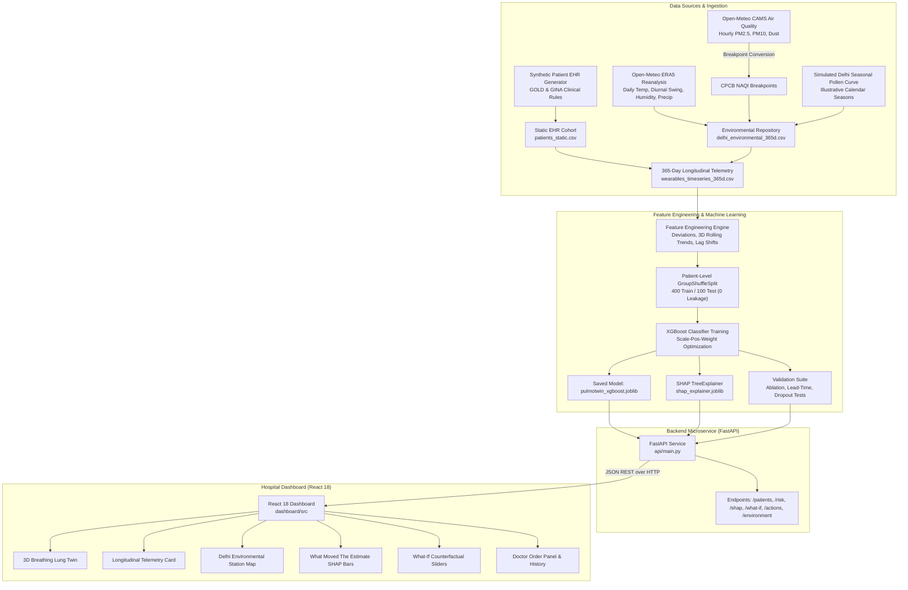

# PulmoTwin System Architecture & Technical Specification

## 1. End-to-End Architectural Overview

PulmoTwin is architected around an asynchronous multi-modal data pipeline connecting real modelled environmental data, clinical EHR phenotypes, continuous wearable time-series, an XGBoost predictive engine, a FastAPI microservice, and a decoupled React clinical dashboard.

## 2. API Endpoints Specification

| Method | Endpoint | Description |
| :--- | :--- | :--- |
| `GET` | `/api/health` | Health check, dataset sizes, model status, and data provenance disclosures. |
| `GET` | `/api/patients` | Cohort list ranked descending by 48-hour flare-up risk score with search & filter parameters. |
| `GET` | `/api/patients/{id}` | Patient EHR profile, individual physiological baselines, prescribed regimen, and comorbidity log. |
| `GET` | `/api/patients/{id}/history` | Multi-sensor wearable telemetry and environmental overlay for 7, 30, or 365 days. |
| `GET` | `/api/patients/{id}/risk` | Real-time 48-hour exacerbation risk probability, risk tier, and alert threshold evaluation. |
| `GET` | `/api/patients/{id}/shap` | Mathematically reconciled SHAP factor attributions with directional shifts. |
| `POST` | `/api/simulate-what-if` | Counterfactual simulation calculating risk changes when adjusting AQI, adherence, or thermal conditions. |
| `GET` | `/api/environment/delhi` | Environmental status across 5 Delhi monitoring locations with current CAMS NAQI, PM2.5, Dust, and Weather. |
| `GET` | `/api/analytics/model-performance` | Comprehensive benchmarking directly from `model/comprehensive_metrics.json`. |
| `POST` | `/api/patients/{id}/actions` | Logs doctor orders (e.g., oral steroid burst, urgent telehealth review, inhaler step-up). |
| `GET` | `/api/patients/{id}/alerts` | 365-day historical alert log with grouped multi-day clinical episodes. |

## 3. Data Attribution & Terms
- **Weather & Reanalysis**: Open-Meteo ERA5-Land reanalysis used under Creative Commons Attribution 4.0 International (CC BY 4.0).
- **Air Quality**: Copernicus Atmosphere Monitoring Service (CAMS) modelled data via Open-Meteo converted to Indian CPCB NAQI breakpoints.
- **Pollen Index**: Illustrative seasonal curve with peaks placed near seasons in Delhi pollen calendars; not fitted to measured data.
- **Patient Cohort**: 500 synthetic COPD and asthma patients. Zero real patient data.
- **License**: MIT License (Copyright (c) 2026 Monalika Doda).
