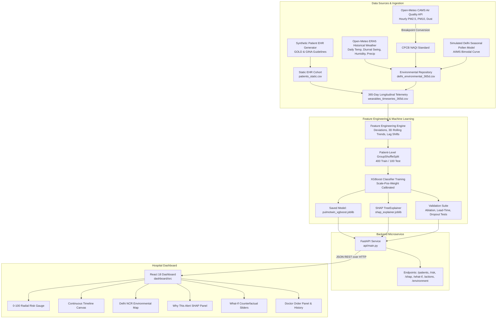

# PulmoTwin System Architecture & Technical Specification

## 1. End-to-End Architectural Overview

PulmoTwin is architected around an asynchronous multi-modal data pipeline connecting environmental intelligence, clinical EHR registries, continuous wearable data streams, an XGBoost predictive engine, a FastAPI microservice, and a decoupled React dashboard.

## 2. API Endpoints Specification

| Method | Endpoint | Description |
| :--- | :--- | :--- |
| `GET` | `/api/health` | Health check, dataset sizes, model status, and data provenance disclosures. |
| `GET` | `/api/patients` | Cohort list ranked descending by 48-hour flare-up risk score with search & filter parameters. |
| `GET` | `/api/patients/{id}` | Patient EHR profile, individual physiological baselines, prescribed regimen, and comorbidity log. |
| `GET` | `/api/patients/{id}/history` | Multi-sensor wearable telemetry and environmental overlay for 7, 30, or 365 days. |
| `GET` | `/api/patients/{id}/risk` | Real-time 48-hour exacerbation risk probability, risk tier, and alert threshold evaluation. |
| `GET` | `/api/patients/{id}/shap` | Top 3–5 local SHAP feature attributions with directional arrows and clinical descriptions. |
| `POST` | `/api/patients/{id}/what-if` | Counterfactual simulation calculating risk reduction when adjusting AQI, adherence, or thermal conditions. |
| `GET` | `/api/environment/delhi` | Environmental status across 5 Delhi monitoring locations with current CAMS NAQI, PM2.5, Dust, and Weather. |
| `GET` | `/api/analytics/model-performance` | Comprehensive benchmarking: 4-stage ablation results, lead-time horizon sensitivity, and sensor dropout curves. |
| `POST` | `/api/patients/{id}/actions` | Logs doctor orders (e.g., oral steroid burst, urgent telehealth review, inhaler step-up). |
| `GET` | `/api/patients/{id}/alerts` | 365-day historical alert log with trigger diagnostics and validation outcomes. |
